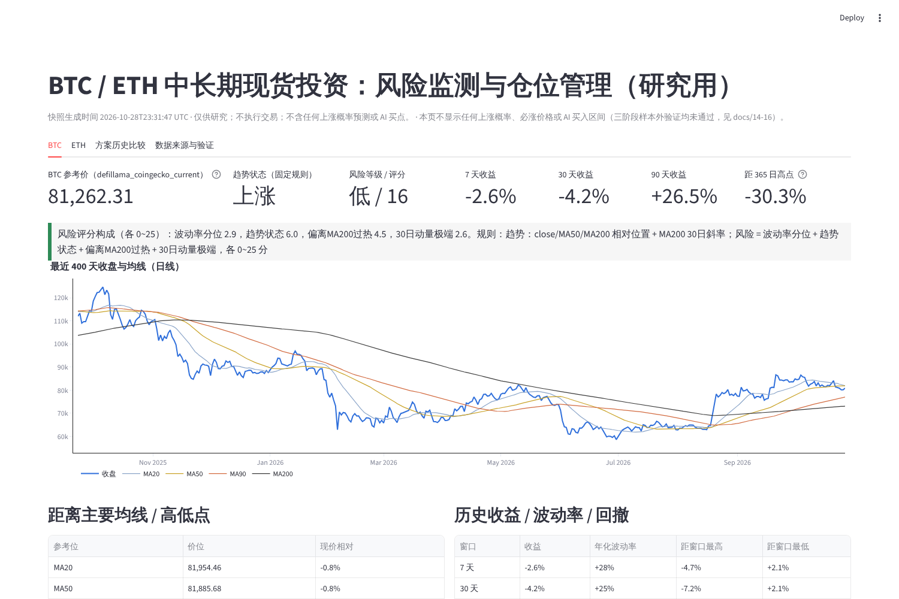
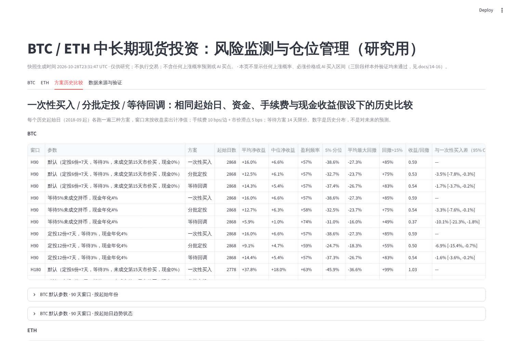

# 17 · 第四阶段：BTC / ETH 中长期现货投资风险监测与仓位管理系统

生成时间：2026-10-28T23:31:47 UTC · 代码 `src/spot90/monitor/`、`src/spot90/dashboard/app.py` · 产物 `reports_out/spot90/monitor/` · 截图 `docs/spot90_validation/phase4/`

> 本系统只做监测、风险度量、仓位算术与历史方案比较；**不输出** 90 天上涨概率、必涨价格或 AI 买入区间（三阶段样本外验证均未通过，见 docs/14-16）；不执行任何真实交易。

## 1. 启动与每日更新

```bash
export PYTHONPATH=src
python -m spot90.cli ingest --no-crosscheck     # 拉取最新日线（Bitget V3 首选 → GitHub 公开 Binance K 线缓存）
python -m spot90.monitor.snapshot              # 生成快照：参考价 + 新鲜度 + 指标 + 趋势/风险 + 成交概率 + 方案摘要
python -m streamlit run src/spot90/dashboard/app.py --server.port 8501   # 中文 Dashboard
bash scripts/spot90_monitor_daily.sh           # 每日：ingest + snapshot（crontab 例见脚本）
python -c "from spot90.backtest.dataset import load_bars; from spot90.monitor.fill_model import validate; validate(load_bars())"   # 重新验证成交概率模型
python -c "from spot90.backtest.dataset import load_bars; from spot90.monitor.plans import run_all; run_all(load_bars())"         # 重新跑方案历史比较
pytest tests/test_spot90_monitor.py -q         # 6 项测试
```

## 2. 数据来源与新鲜度（本次快照）

| 标的 | 日线来源 | 日线范围 | 日线新鲜度 | 参考价来源 | 参考价时间 | 延迟 | 状态 | Bitget 探测 |
|---|---|---|---|---|---|---|---|---|
| BTCUSDT | binance_spot_via_static_klines | 2017-08-17 → 2026-10-27（3359 根） | 正常 | defillama_coingecko_current | 2026-10-28T23:29:50 | 117 秒 | 正常 | api.bitget.com 不可达或拒绝：BitgetUnreachable: ProxyError: 403 Forbidden |
| ETHUSDT | binance_spot_via_static_klines | 2017-08-17 → 2026-10-27（3359 根） | 正常 | defillama_coingecko_current | 2026-10-28T23:29:50 | 117 秒 | 正常 | api.bitget.com 不可达或拒绝：BitgetUnreachable: ProxyError: 403 Forbidden |

- 新鲜度规则：昨日 UTC 日线已收盘 = 0 天延迟；≥1 天标“日线延迟 N 天”；参考价时间戳超过 30 分钟标“延迟”；三个来源全部失败标“不可用”并回退显示最后日线收盘且页顶警告。页面永远注明价格是“参考价（来源）”还是“最后日线收盘（延迟）”。
- 日线是 Binance 现货（GitHub `finom/static-klines` 每日 03:17 UTC 更新）；Bitget 现货 ticker 与 V3 K 线在能访问 api.bitget.com 的机器上自动成为首选。参考价为 CoinGecko 聚合价，与 Bitget 成交价可能有万分之几差异。

## 3. 固定规则（公开）

- 趋势状态：强势上涨 = close>MA50>MA200 且 MA200 30 日斜率>0；上涨 = close>MA200 且斜率>0；下跌 = close<MA200 且斜率<0；强势下跌 = close<MA50<MA200 且斜率<0；其余震荡。
- 风险评分 0~100 = 波动率分位(rv20 在过去 365 天的分位×25) + 趋势状态(0/6/12/19/25) + 偏离 MA200 过热(0~+60% 线性→0~25) + 30 日动量极端(|30 日收益| 0~40% 线性→0~25)；<30 低、30~50 中、50~70 高、≥70 极高。
- 当前 BTC：价格 81,262.31（参考价（defillama_coingecko_current）），趋势 **上涨**，风险 **低 16**（波动率分位 2.9，趋势状态 6.0，偏离MA200过热 4.5，30日动量极端 2.6）；7/30/90 天收益 -2.6% / -4.2% / 26.5%；年化波动 30 天 25%；距 MA200 11.2%，距 365 日高点 -30.0%，距 30 日低点 2.6%。
- 当前 ETH：价格 2,358.75（参考价（defillama_coingecko_current）），趋势 **上涨**，风险 **低 20**（波动率分位 2.9，趋势状态 6.0，偏离MA200过热 3.7，30日动量极端 7.9）；7/30/90 天收益 -4.0% / -12.6% / 23.0%；年化波动 30 天 33%；距 MA200 9.2%，距 365 日高点 -43.5%，距 30 日低点 3.3%。

## 4. 14 天限价单成交概率模型：重新验证

Walk-Forward 样本外 2020-01-01 → 2026-07-15，n = 57,312（2 币种 × 12 档折价 × 决策日）。

| 模型 | AUC | Brier | ECE | 预测均值 / 真实成交率 |
|---|---|---|---|---|
| 逻辑回归（本阶段，特征：折价/14 天波动标准化距离、log 波动率、折价、30 日收益、趋势状态） | 0.784 | 0.188 | 0.046 | 60.1% / 58.7% |
| 第一阶段 LightGBM（原始概率，对照） | 0.746 | 0.212 | 0.102 | 61.6% / 58.7% |

跨市场状态稳定性（逻辑回归，AUC / ECE）：

| 维度 | 上涨 | 下跌 | 强势上涨 | 强势下跌 | 震荡 |
|---|---|---|---|---|---|
| 趋势状态 | 0.754 / 0.062 | 0.752 / 0.046 | 0.804 / 0.040 | 0.800 / 0.068 | 0.788 / 0.048 |
| 维度 | 中波动 | 低波动 | 高波动 | | |
|---|---|---|---|---|---|
| 波动分位 | 0.787 / 0.051 | 0.760 / 0.044 | 0.808 / 0.051 | | |
| 年份 | 2020: 0.81/0.17 | 2021: 0.77/0.05 | 2022: 0.76/0.07 | 2023: 0.83/0.12 | 2024: 0.79/0.04 | 2025: 0.78/0.04 | 2026: 0.78/0.06 |
| 币种 | BTCUSDT: 0.787/0.056 | ETHUSDT: 0.777/0.043 |

可靠性表（预测概率桶 → 真实成交率）：0.0-0.1: 预测 0.08 真实 0.16 (n=962)；0.1-0.2: 预测 0.15 真实 0.22 (n=3751)；0.2-0.3: 预测 0.25 真实 0.28 (n=3985)；0.3-0.4: 预测 0.35 真实 0.34 (n=4408)；0.4-0.5: 预测 0.45 真实 0.40 (n=5079)；0.5-0.6: 预测 0.55 真实 0.48 (n=6311)；0.6-0.7: 预测 0.65 真实 0.57 (n=8128)；0.7-0.8: 预测 0.75 真实 0.72 (n=10114)；0.8-0.9: 预测 0.85 真实 0.88 (n=11494)；0.9-1.0: 预测 0.92 真实 0.97 (n=3080)

**成交概率 ≠ 盈利概率**（历史事实，同一批样本外日期）：

| 折价 | 真实 14 天成交率 | 成交后 90 天盈利率 | 成交后 90 天均值收益 | 同批日期立即买入均值 |
|---|---|---|---|---|
| 0% | 100% | 57.7% | 17.8% | 17.7% |
| 1% | 91% | 57.2% | 17.2% | 17.7% |
| 2% | 83% | 56.9% | 16.7% | 17.7% |
| 3% | 75% | 56.3% | 16.2% | 17.7% |
| 4% | 67% | 56.2% | 15.6% | 17.7% |
| 5% | 60% | 56.6% | 15.5% | 17.7% |
| 6% | 54% | 57.0% | 15.3% | 17.7% |
| 7% | 48% | 57.1% | 15.2% | 17.7% |
| 8% | 44% | 58.2% | 15.3% | 17.7% |
| 10% | 35% | 58.7% | 15.8% | 17.7% |
| 12% | 28% | 59.3% | 15.9% | 17.7% |
| 15% | 20% | 59.7% | 16.6% | 17.7% |

结论：成交概率模型跨状态稳定（AUC 0.75~0.83，ECE ≤ 0.07，仅 2020 年 ECE 0.17 偏高），可以用来回答“挂这个价 14 天内大概率能不能买到”；但无论折价多少，成交后 90 天盈利率都是 56%~60%，均值收益不高于立即买入，所以它**不是**盈利信号。

## 5. 一次性买入 / 分批定投 / 等待回调：历史比较

口径：每个历史起始日各跑一遍；资金 10,000 USDT；手续费 10 bps/边 + 市价滑点 5 bps（限价成交无滑点）；窗口末按收盘卖出；最大回撤为窗口内权益（含现金）相对峰值；与一次性买入的差值用块自助（块长 = 窗口天数）95% CI。

### BTC

| 窗口 | 参数 | 方案 | 起始日数 | 平均净收益 | 中位 | 盈利频率 | 5% 分位 | 平均最大回撤 | 回撤>15% | 收益/回撤 | 与一次性买入差（95% CI） | 成交率 |
|---|---|---|---|---|---|---|---|---|---|---|---|---|
| H90 | 默认（定投6份×7天，等待3%，未成交第15天市价买，现金0%） | 一次性买入 | 2868 | 16.0% | 6.6% | 57% | -38.6% | -27.3% | 85% | 0.59 | — | — |
| H90 | 默认（定投6份×7天，等待3%，未成交第15天市价买，现金0%） | 分批定投 | 2868 | 12.5% | 6.1% | 57% | -32.7% | -23.7% | 75% | 0.53 | -3.5% [-7.8%, -0.3%] | — |
| H90 | 默认（定投6份×7天，等待3%，未成交第15天市价买，现金0%） | 等待回调 | 2868 | 14.3% | 5.4% | 57% | -37.4% | -26.7% | 83% | 0.54 | -1.7% [-3.7%, -0.2%] | 72% |
| H90 | 等待5%未成交持币，现金年化4% | 一次性买入 | 2868 | 16.0% | 6.6% | 57% | -38.6% | -27.3% | 85% | 0.59 | — | — |
| H90 | 等待5%未成交持币，现金年化4% | 分批定投 | 2868 | 12.7% | 6.3% | 58% | -32.5% | -23.7% | 75% | 0.54 | -3.3% [-7.6%, -0.1%] | — |
| H90 | 等待5%未成交持币，现金年化4% | 等待回调 | 2868 | 5.9% | 1.0% | 74% | -31.0% | -16.0% | 49% | 0.37 | -10.1% [-21.3%, -1.8%] | 56% |
| H90 | 定投12份×7天，等待3%，现金年化4% | 一次性买入 | 2868 | 16.0% | 6.6% | 57% | -38.6% | -27.3% | 85% | 0.59 | — | — |
| H90 | 定投12份×7天，等待3%，现金年化4% | 分批定投 | 2868 | 9.1% | 4.7% | 59% | -24.7% | -18.3% | 55% | 0.50 | -6.9% [-15.4%, -0.7%] | — |
| H90 | 定投12份×7天，等待3%，现金年化4% | 等待回调 | 2868 | 14.4% | 5.4% | 57% | -37.3% | -26.7% | 83% | 0.54 | -1.6% [-3.6%, -0.2%] | 72% |
| H180 | 默认（定投6份×7天，等待3%，未成交第15天市价买，现金0%） | 一次性买入 | 2778 | 37.8% | 18.0% | 63% | -45.9% | -36.6% | 99% | 1.03 | — | — |
| H180 | 默认（定投6份×7天，等待3%，未成交第15天市价买，现金0%） | 分批定投 | 2778 | 34.0% | 12.8% | 62% | -42.0% | -34.3% | 98% | 0.99 | -3.7% [-8.6%, -0.6%] | — |
| H180 | 默认（定投6份×7天，等待3%，未成交第15天市价买，现金0%） | 等待回调 | 2778 | 35.8% | 16.7% | 62% | -44.5% | -36.2% | 99% | 0.99 | -2.0% [-4.2%, -0.4%] | 72% |
| H180 | 等待5%未成交持币，现金年化4% | 一次性买入 | 2778 | 37.8% | 18.0% | 63% | -45.9% | -36.6% | 99% | 1.03 | — | — |
| H180 | 等待5%未成交持币，现金年化4% | 分批定投 | 2778 | 34.2% | 13.0% | 62% | -41.8% | -34.3% | 98% | 1.00 | -3.5% [-8.4%, -0.4%] | — |
| H180 | 等待5%未成交持币，现金年化4% | 等待回调 | 2778 | 15.5% | 2.0% | 76% | -41.3% | -21.7% | 55% | 0.71 | -22.3% [-45.6%, -4.9%] | 56% |
| H180 | 定投12份×7天，等待3%，现金年化4% | 一次性买入 | 2778 | 37.8% | 18.0% | 63% | -45.9% | -36.6% | 99% | 1.03 | — | — |
| H180 | 定投12份×7天，等待3%，现金年化4% | 分批定投 | 2778 | 29.8% | 13.1% | 62% | -38.0% | -31.3% | 95% | 0.95 | -8.0% [-18.2%, -0.9%] | — |
| H180 | 定投12份×7天，等待3%，现金年化4% | 等待回调 | 2778 | 35.8% | 16.7% | 62% | -44.5% | -36.2% | 99% | 0.99 | -1.9% [-4.1%, -0.3%] | 72% |
| H365 | 默认（定投6份×7天，等待3%，未成交第15天市价买，现金0%） | 一次性买入 | 2593 | 85.2% | 44.8% | 66% | -56.1% | -47.6% | 100% | 1.79 | — | — |
| H365 | 默认（定投6份×7天，等待3%，未成交第15天市价买，现金0%） | 分批定投 | 2593 | 80.0% | 39.1% | 66% | -57.3% | -46.4% | 100% | 1.72 | -5.2% [-13.0%, -1.0%] | — |
| H365 | 默认（定投6份×7天，等待3%，未成交第15天市价买，现金0%） | 等待回调 | 2593 | 82.6% | 43.6% | 66% | -55.7% | -47.4% | 100% | 1.74 | -2.6% [-5.6%, -0.9%] | 72% |
| H365 | 等待5%未成交持币，现金年化4% | 一次性买入 | 2593 | 85.2% | 44.8% | 66% | -56.1% | -47.6% | 100% | 1.79 | — | — |
| H365 | 等待5%未成交持币，现金年化4% | 分批定投 | 2593 | 80.2% | 39.3% | 66% | -57.1% | -46.4% | 100% | 1.73 | -5.0% [-12.8%, -0.8%] | — |
| H365 | 等待5%未成交持币，现金年化4% | 等待回调 | 2593 | 45.2% | 4.0% | 78% | -45.2% | -27.7% | 56% | 1.64 | -39.9% [-81.5%, -14.3%] | 56% |
| H365 | 定投12份×7天，等待3%，现金年化4% | 一次性买入 | 2593 | 85.2% | 44.8% | 66% | -56.1% | -47.6% | 100% | 1.79 | — | — |
| H365 | 定投12份×7天，等待3%，现金年化4% | 分批定投 | 2593 | 74.2% | 44.9% | 66% | -58.4% | -44.9% | 100% | 1.65 | -10.9% [-27.6%, -2.2%] | — |
| H365 | 定投12份×7天，等待3%，现金年化4% | 等待回调 | 2593 | 82.7% | 43.7% | 66% | -55.6% | -47.4% | 100% | 1.74 | -2.4% [-5.4%, -0.8%] | 72% |

按起始日趋势状态（默认参数，90 天）：

| 趋势状态 | 起始日数 | 一次性 均值/回撤 | 定投 均值/回撤 | 等待 均值/回撤 |
|---|---|---|---|---|
| 上涨 | 524 | 10.4% / -25.5% | 9.9% / -21.8% | 10.2% / -24.8% |
| 下跌 | 322 | 14.5% / -32.5% | 10.7% / -27.7% | 10.8% / -31.6% |
| 强势上涨 | 877 | 21.2% / -26.2% | 14.9% / -23.5% | 18.4% / -25.5% |
| 强势下跌 | 541 | 2.6% / -28.3% | 3.2% / -23.8% | 2.8% / -27.8% |
| 震荡 | 604 | 26.1% / -26.8% | 20.6% / -23.4% | 24.2% / -26.3% |

按起始年份（默认参数，90 天）：

| 年份 | 起始日数 | 一次性 均值/回撤 | 定投 均值/回撤 | 等待 均值/回撤 |
|---|---|---|---|---|
| 2018 | 102 | -24.0% / -38.7% | -16.5% / -30.0% | -22.6% / -37.7% |
| 2019 | 365 | 31.2% / -29.2% | 24.1% / -26.4% | 27.4% / -28.6% |
| 2020 | 366 | 64.5% / -28.7% | 50.6% / -24.3% | 57.6% / -28.2% |
| 2021 | 365 | 4.9% / -37.2% | 2.6% / -32.9% | 4.7% / -36.5% |
| 2022 | 365 | -9.7% / -33.1% | -7.0% / -28.3% | -8.7% / -32.4% |
| 2023 | 365 | 25.0% / -16.9% | 20.0% / -15.0% | 22.7% / -16.3% |
| 2024 | 366 | 18.3% / -21.8% | 13.2% / -19.8% | 16.4% / -21.4% |
| 2025 | 365 | -3.3% / -24.1% | -3.2% / -21.4% | -3.1% / -23.5% |
| 2026 | 209 | 1.9% / -22.0% | 4.5% / -17.1% | 3.0% / -21.0% |

### ETH

| 窗口 | 参数 | 方案 | 起始日数 | 平均净收益 | 中位 | 盈利频率 | 5% 分位 | 平均最大回撤 | 回撤>15% | 收益/回撤 | 与一次性买入差（95% CI） | 成交率 |
|---|---|---|---|---|---|---|---|---|---|---|---|---|
| H90 | 默认（定投6份×7天，等待3%，未成交第15天市价买，现金0%） | 一次性买入 | 2868 | 18.4% | 8.7% | 57% | -42.1% | -35.2% | 95% | 0.52 | — | — |
| H90 | 默认（定投6份×7天，等待3%，未成交第15天市价买，现金0%） | 分批定投 | 2868 | 14.9% | 7.9% | 58% | -37.2% | -30.7% | 91% | 0.48 | -3.5% [-8.2%, 0.0%] | — |
| H90 | 默认（定投6份×7天，等待3%，未成交第15天市价买，现金0%） | 等待回调 | 2868 | 17.0% | 6.3% | 56% | -41.4% | -34.5% | 95% | 0.49 | -1.4% [-2.6%, -0.4%] | 79% |
| H90 | 等待5%未成交持币，现金年化4% | 一次性买入 | 2868 | 18.4% | 8.7% | 57% | -42.1% | -35.2% | 95% | 0.52 | — | — |
| H90 | 等待5%未成交持币，现金年化4% | 分批定投 | 2868 | 15.1% | 8.1% | 58% | -37.0% | -30.7% | 91% | 0.49 | -3.3% [-8.0%, 0.2%] | — |
| H90 | 等待5%未成交持币，现金年化4% | 等待回调 | 2868 | 11.5% | 1.0% | 71% | -38.1% | -23.3% | 62% | 0.49 | -6.9% [-14.5%, -0.9%] | 66% |
| H90 | 定投12份×7天，等待3%，现金年化4% | 一次性买入 | 2868 | 18.4% | 8.7% | 57% | -42.1% | -35.2% | 95% | 0.52 | — | — |
| H90 | 定投12份×7天，等待3%，现金年化4% | 分批定投 | 2868 | 10.9% | 6.0% | 60% | -30.3% | -24.0% | 75% | 0.46 | -7.4% [-16.9%, -0.6%] | — |
| H90 | 定投12份×7天，等待3%，现金年化4% | 等待回调 | 2868 | 17.1% | 6.4% | 56% | -41.4% | -34.5% | 95% | 0.49 | -1.3% [-2.5%, -0.3%] | 79% |
| H180 | 默认（定投6份×7天，等待3%，未成交第15天市价买，现金0%） | 一次性买入 | 2778 | 45.3% | 14.3% | 61% | -54.3% | -46.8% | 100% | 0.97 | — | — |
| H180 | 默认（定投6份×7天，等待3%，未成交第15天市价买，现金0%） | 分批定投 | 2778 | 40.2% | 15.3% | 59% | -50.0% | -44.1% | 100% | 0.91 | -5.1% [-13.9%, 0.0%] | — |
| H180 | 默认（定投6份×7天，等待3%，未成交第15天市价买，现金0%） | 等待回调 | 2778 | 43.2% | 14.4% | 61% | -53.6% | -46.4% | 100% | 0.93 | -2.1% [-4.2%, -0.5%] | 79% |
| H180 | 等待5%未成交持币，现金年化4% | 一次性买入 | 2778 | 45.3% | 14.3% | 61% | -54.3% | -46.8% | 100% | 0.97 | — | — |
| H180 | 等待5%未成交持币，现金年化4% | 分批定投 | 2778 | 40.4% | 15.5% | 60% | -49.8% | -44.0% | 100% | 0.92 | -4.9% [-13.7%, 0.2%] | — |
| H180 | 等待5%未成交持币，现金年化4% | 等待回调 | 2778 | 27.7% | 2.0% | 73% | -50.2% | -31.4% | 66% | 0.88 | -17.6% [-41.0%, -2.1%] | 66% |
| H180 | 定投12份×7天，等待3%，现金年化4% | 一次性买入 | 2778 | 45.3% | 14.3% | 61% | -54.3% | -46.8% | 100% | 0.97 | — | — |
| H180 | 定投12份×7天，等待3%，现金年化4% | 分批定投 | 2778 | 34.7% | 15.7% | 60% | -43.8% | -40.3% | 99% | 0.86 | -10.6% [-29.0%, -0.0%] | — |
| H180 | 定投12份×7天，等待3%，现金年化4% | 等待回调 | 2778 | 43.3% | 14.4% | 61% | -53.6% | -46.4% | 100% | 0.93 | -2.0% [-4.1%, -0.5%] | 79% |
| H365 | 默认（定投6份×7天，等待3%，未成交第15天市价买，现金0%） | 一次性买入 | 2593 | 142.0% | 30.6% | 61% | -55.7% | -59.1% | 100% | 2.40 | — | — |
| H365 | 默认（定投6份×7天，等待3%，未成交第15天市价买，现金0%） | 分批定投 | 2593 | 131.1% | 30.0% | 63% | -56.0% | -57.8% | 100% | 2.27 | -11.0% [-33.2%, 0.1%] | — |
| H365 | 默认（定投6份×7天，等待3%，未成交第15天市价买，现金0%） | 等待回调 | 2593 | 137.8% | 30.2% | 60% | -55.9% | -58.9% | 100% | 2.34 | -4.2% [-10.3%, -0.3%] | 79% |
| H365 | 等待5%未成交持币，现金年化4% | 一次性买入 | 2593 | 142.0% | 30.6% | 61% | -55.7% | -59.1% | 100% | 2.40 | — | — |
| H365 | 等待5%未成交持币，现金年化4% | 分批定投 | 2593 | 131.3% | 30.1% | 63% | -55.8% | -57.7% | 100% | 2.27 | -10.8% [-33.0%, 0.2%] | — |
| H365 | 等待5%未成交持币，现金年化4% | 等待回调 | 2593 | 88.9% | 4.0% | 72% | -49.7% | -39.6% | 66% | 2.24 | -53.1% [-136.7%, -4.4%] | 66% |
| H365 | 定投12份×7天，等待3%，现金年化4% | 一次性买入 | 2593 | 142.0% | 30.6% | 61% | -55.7% | -59.1% | 100% | 2.40 | — | — |
| H365 | 定投12份×7天，等待3%，现金年化4% | 分批定投 | 2593 | 118.9% | 25.6% | 68% | -57.2% | -56.0% | 100% | 2.12 | -23.1% [-70.9%, 0.5%] | — |
| H365 | 定投12份×7天，等待3%，现金年化4% | 等待回调 | 2593 | 137.9% | 30.2% | 61% | -55.9% | -58.9% | 100% | 2.34 | -4.1% [-10.1%, -0.3%] | 79% |

按起始日趋势状态（默认参数，90 天）：

| 趋势状态 | 起始日数 | 一次性 均值/回撤 | 定投 均值/回撤 | 等待 均值/回撤 |
|---|---|---|---|---|
| 上涨 | 437 | 12.1% / -33.8% | 11.9% / -29.1% | 11.5% / -33.0% |
| 下跌 | 406 | 19.3% / -35.4% | 16.2% / -31.0% | 17.9% / -34.6% |
| 强势上涨 | 822 | 31.3% / -36.2% | 23.7% / -31.9% | 29.6% / -35.6% |
| 强势下跌 | 578 | 17.2% / -34.9% | 15.0% / -30.3% | 15.6% / -34.3% |
| 震荡 | 625 | 6.2% / -34.9% | 4.4% / -30.6% | 5.1% / -34.3% |

按起始年份（默认参数，90 天）：

| 年份 | 起始日数 | 一次性 均值/回撤 | 定投 均值/回撤 | 等待 均值/回撤 |
|---|---|---|---|---|
| 2018 | 102 | -13.5% / -51.1% | -7.3% / -42.8% | -14.9% / -50.2% |
| 2019 | 365 | 16.0% / -36.5% | 14.7% / -32.5% | 15.2% / -35.7% |
| 2020 | 366 | 84.9% / -34.9% | 66.1% / -30.3% | 79.1% / -34.5% |
| 2021 | 365 | 26.2% / -42.9% | 19.5% / -38.0% | 24.4% / -42.4% |
| 2022 | 365 | -8.7% / -41.8% | -5.3% / -35.8% | -8.1% / -41.1% |
| 2023 | 365 | 17.8% / -18.5% | 14.6% / -16.8% | 17.0% / -18.0% |
| 2024 | 366 | 2.1% / -33.1% | -0.1% / -29.7% | 1.1% / -32.5% |
| 2025 | 365 | 7.6% / -37.8% | 5.6% / -32.8% | 6.5% / -36.9% |
| 2026 | 209 | 3.5% / -28.8% | 6.8% / -23.4% | 4.1% / -28.1% |

### 方案比较结论

- 在 2018-09 → 2026-07 的全部起始日上，**一次性买入的平均净收益最高**，分批定投与等待回调的平均收益显著更低（差值 95% CI 全部不含 0 或贴近 0），这是上涨样本多于下跌样本的直接结果，不是择时能力。
- 分批定投把 90 天窗口的平均最大回撤从 BTC −27.3% 降到 −23.7%、ETH −35.2% 降到 −30.7%，回撤>15% 的频率从 85% 降到 75%（BTC），代价是平均收益少 3~4 个百分点；收益/回撤比（0.53 vs 0.59）并没有提高。12 份定投进一步降回撤、也进一步降收益。
- 等待回调（未成交持币）是回撤最小的方案（BTC 90 天 −16%），但平均收益只有一次性买入的 1/3~1/2，并且下跌年份（2022、2025）它的优势完全来自“少买”，上涨年份（2020、2023、2024）则大幅落后。
- 按起始日趋势状态分组，没有一种状态下定投或等待能在收益上胜过一次性买入；“强势下跌”状态起始的一次性买入历史均值最低、回撤最大，但样本内也不能用来择时（第三阶段已验证）。
- 因此本系统把三种方案并列展示为**风险偏好选择**（能承受多大回撤换多少期望收益），而不是推荐某一种。

## 6. Dashboard 实际界面





其余：`docs/spot90_validation/phase4/dashboard_eth.png`、`dashboard_sources.png`。页面包含：参考价与新鲜度、趋势状态、风险等级与构成、400 天均线图、距均线/高低点表、7/30/90 天收益-波动-回撤、90 天风险评分曲线、当前趋势状态下的历史 90 天统计（标注为描述性）、限价成交概率表（并列历史成交后盈利率以示区别）、持仓成本/止损/潜在亏损计算器与情景表、三方案历史比较、数据来源与验证摘要。

## 7. 已知限制

- 本环境 api.bitget.com 被拒绝：日线与参考价均非 Bitget 成交价；在本机运行时会自动切换到 Bitget。
- 日线来自 GitHub 每日更新的缓存，最新完整日线通常滞后到前一 UTC 日；盘中价格只有 CoinGecko 聚合参考价（分钟级延迟）。
- 风险评分是固定规则的度量，不是预测；第三阶段已证明趋势状态对 90 天结果几乎无区分力，因此页面所有条件统计都标注“描述性”。
- 方案比较用日线开盘/最低价近似成交，未计入盘口冲击；资金 1 万 USDT 量级下主流币影响可忽略。
- 链上数据（Coin Metrics 归档止于 2026-05-23）未纳入监测页面，因为第二、三阶段显示无增益。